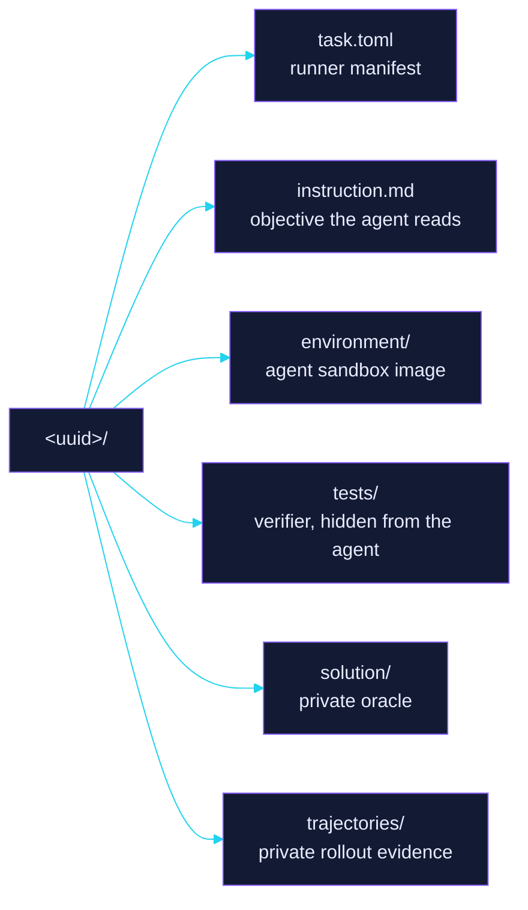

GENERATED SECTION. DO NOT HAND-EDIT.

# samples

The curated lane of this corpus: at most 30 Harbor task bundles, every anchor seated first and every other bundle in seal order. Bundles past that ceiling live in `delivery/`.

Each bundle is one Harbor task in a directory named by its content-derived uuid5, so the name doubles as an integrity check. `trinity/tools/pipeline.py reconcile` renders this page from the resident bundles on every run; a value a bundle does not carry reads `absent`, and the page never fills one in.

## Promoted set

| Property | Value |
| --- | --- |
| Bundles | 3 of 30 |
| Sealed | 0 of 3 |
| Registrations | unregistered (3) |
| Audit verdicts | none (3) |
| Harbor schema | 1.4 (3) |
| Difficulty | measured by the signed pilot alone, never declared in a bundle |

| Bundle | Task | Keywords | Registration | Sealed at |
| --- | --- | --- | --- | --- |
| [`07677d65-2e74-5fec-a1cc-e2588279e654`](07677d65-2e74-5fec-a1cc-e2588279e654/) | `teresa/07677d65-2e74-5fec-a1cc-e2588279e654` | function_localization, java | unregistered | unsealed |
| [`b93729aa-2cbe-516d-94b6-c09b55d1c743`](b93729aa-2cbe-516d-94b6-c09b55d1c743/) | `teresa/b93729aa-2cbe-516d-94b6-c09b55d1c743` | issue_localization, rust | unregistered | unsealed |
| [`c94fe5ad-d4c9-5c02-b0d2-97c82ef296fe`](c94fe5ad-d4c9-5c02-b0d2-97c82ef296fe/) | `teresa/c94fe5ad-d4c9-5c02-b0d2-97c82ef296fe` | issue_localization, rust | unregistered | unsealed |

## Standing

The verdict is the audit outcome recorded at the sealed digest, and `none` means no verdict has landed for that digest yet. Only a FORGE invocation removes a bundle from this lane, so removal waits for the next one.

| uuid | Verdict | Sealed digest | Stream |
| --- | --- | --- | --- |
| 07677d65-2e74-5fec-a1cc-e2588279e654 | none | absent | none |
| b93729aa-2cbe-516d-94b6-c09b55d1c743 | none | absent | none |
| c94fe5ad-d4c9-5c02-b0d2-97c82ef296fe | none | absent | none |

## Screening roots

Each bundle's signed provenance carrier holds its screening roots, screening instant, and absolute expiry. Placement moves that carrier into the private derivation set, which this page never reads, so reconcile lists no root it cannot verify here.
