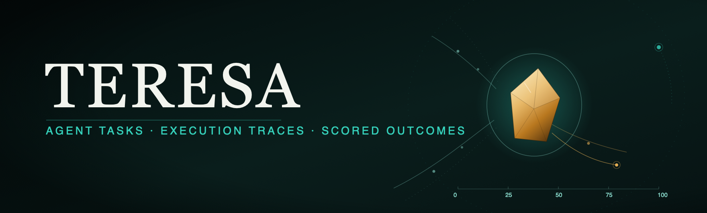
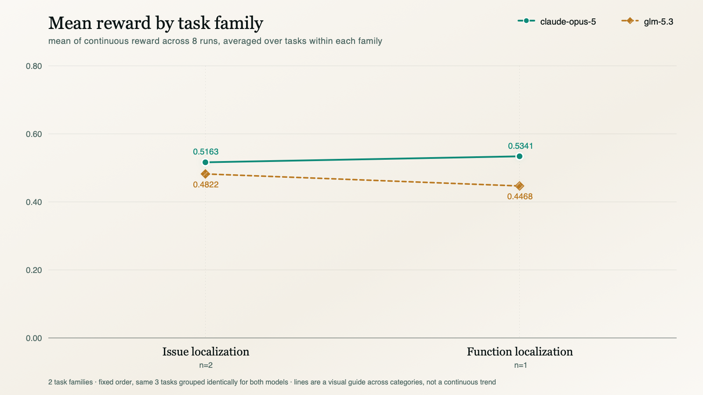
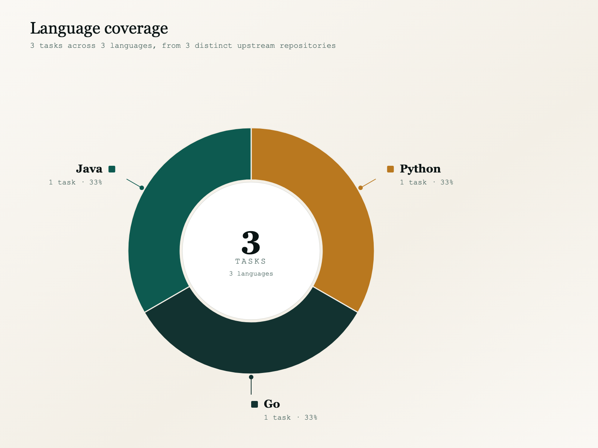

<p align="center">
  <picture>
    <source type="image/svg+xml" srcset="images/hero.svg">
    
  </picture>
</p>

<p align="center">
  <strong>Read-only source-code-comprehension tasks for coding agents, graded on a composite of deterministic checks and rubric criteria.</strong>
</p>

<p align="center"><sub>
  <a href="#summary">Summary</a> · <a href="#results">Results</a> · <a href="#coverage">Coverage</a> · <a href="#task-list">Tasks</a> · <a href="#repository-structure">Structure</a> · <a href="#scoring-methodology">Scoring</a> · <a href="#reproduction">Reproduction</a>
</sub></p>

# Teresa: 3-Task Sample

**Teresa asks a coding agent to explain how a real codebase behaves — trace a failing dispatch path, locate the function a natural-language description points at, name the exact fork in the logic — without changing any code.** The agent gets a repository checked out at a fixed commit and a natural-language question, instructed to answer in prose rather than edit files. Consistent with that instruction, every one of the 48 sampled runs' collected `agent.patch` is exactly 0 bytes — evidence the instruction was followed, not a mechanism that guarantees no file was touched. This is a read-only comprehension domain, not a patch-and-test repair domain.

Each task belongs to one of two families, drawn directly from `task.toml`'s own `family` field — there is no invented difficulty tier or calibration score anywhere in this document:

| family | tasks | what the agent is asked to do |
| :--- | :--: | :--- |
| `issue_localization` | 2 | trace a specific misbehavior through the real call graph and name the exact file/routine/branch responsible |
| `function_localization` | 1 | locate the function that implements a described behavior, from a natural-language description alone |

This sample is **3 tasks × 2 models × 8 runs = 48 unique runs**, sourced from the `run-01`…`run-08` directories under each task's `trajectories/<trial>/`, where `<trial>` is `claude-opus-5` or `glm-5.3`.

## Summary

| Property | Value |
| :--- | :--- |
| Tasks | **3**, across **3** distinct upstream repositories (one task each) |
| Models | `claude-opus-5` and `glm-5.3` — the `agent.model_name` recorded in every run's `config.json` is `anthropic/claude-opus-5` or the `glm-5.3` equivalent |
| Runs & grid | 8 per model per task = **48 total**; full 2 × 8 grid on every task, no gaps |
| Task families | `issue_localization` (2), `function_localization` (1) — from `task.toml`, not a derived difficulty label |
| Agent harness | `openhands` `0.62.0`, `max_iterations=200`, `temperature=1.0`, `caching_prompt=true` — from every run's `config.json` |
| Reward | `reward = mean(pytest, rubric)` ∈ [0, 1] — see [Scoring methodology](#scoring-methodology) |
| Languages | 2 (Rust 2, Java 1) — from `task.toml`'s `language` field |
| Domain | read-only comprehension: `agent.patch` is 0 bytes on all 48 sampled runs |
| Grading integrity | `graded_ok: true` on all 48 runs' `reward-details.json` — nothing was voided or flagged |

| metric | claude-opus-5 | glm-5.3 |
|---|--:|--:|
| mean task **mean reward** (plain average of the continuous reward, averaged over the 3 tasks) | **0.5223** | 0.4704 |

With three tasks and two families, every figure in this document is a small-sample figure. The per-task numbers are each 8 runs; the family numbers are 2 tasks and 1 task respectively. They are reported as what they are — this corpus's measurements — not as estimates of either model's general capability.

## Results

Both models group the same 3 tasks into the same 2 families in the same fixed order — there is no invented tier or per-model regrouping anywhere in this document. Every family figure is the mean of that family's task-level mean-reward values, each task weighted equally regardless of how many other tasks share its family (so `function_localization`, with 1 task, is exactly that one task's number).

### Mean reward by task family

<picture>
  <source media="(prefers-color-scheme: dark)" srcset="images/mean_reward_by_family-dark.svg">
  <source media="(prefers-color-scheme: light)" srcset="images/mean_reward_by_family-light.svg">
  
</picture>

| family | tasks | claude-opus-5 mean reward | glm-5.3 mean reward |
| :--- | :--: | --: | --: |
| `issue_localization` | 2 | **0.5163** | 0.4822 |
| `function_localization` | 1 | **0.5341** | 0.4468 |

On the continuous score, claude-opus-5 leads in both families — the model clears the mid-range consistently, whereas glm-5.3 shows wider run-to-run variance on `issue_localization` (its top run on `swc-project/swc` scored 0.7825, well above the family mean, while its worst run on the same task scored 0.3862).

## Coverage

<picture>
  <source media="(prefers-color-scheme: dark)" srcset="images/tasks_by_language-dark.svg">
  <source media="(prefers-color-scheme: light)" srcset="images/tasks_by_language-light.svg">
  
</picture>

**3 tasks across 2 languages, from 3 distinct upstream repositories.** Language is read directly from each task's `task.toml` `language` field.

| language | tasks | repositories |
| :--- | :--: | :--- |
| Rust | 2 | `boundless-xyz/boundless`, `swc-project/swc` |
| Java | 1 | `hibernate/hibernate-orm` |

Every repository supplies exactly one task, so the task and repository counts coincide at three; no repository is weighted more heavily than another anywhere in this document.

## Task list

Mean reward is the plain average of the continuous `reward` across each task's 8 runs, per model. `commit` is the `base_commit` short hash the task was pinned to, from `task.toml`.

| task | repo @ commit | family | lang | opus-5 reward | glm-5.3 reward |
|---|---|---|:--:|--:|--:|
| [`b93729aa`](b93729aa-2cbe-516d-94b6-c09b55d1c743/) | [boundless-xyz/boundless@8dab3ba](https://github.com/boundless-xyz/boundless/commit/8dab3ba0c959646e422cc80259dbe6e7f331b383) | `issue_localization` | rust | **0.5282** | 0.4123 |
| [`07677d65`](07677d65-2e74-5fec-a1cc-e2588279e654/) | [hibernate/hibernate-orm@a512ede](https://github.com/hibernate/hibernate-orm/commit/a512ede38b693769d8fd801a23c5c7b640df6f7f) | `function_localization` | java | **0.5341** | 0.4468 |
| [`c94fe5ad`](c94fe5ad-d4c9-5c02-b0d2-97c82ef296fe/) | [swc-project/swc@c55e524](https://github.com/swc-project/swc/commit/c55e52479765bf14c7d241efa70cca861d7699e5) | `issue_localization` | rust | 0.5045 | **0.5521** |

## Repository structure

```
teresa-samples/
├── README.md
├── images/                       # pre-generated chart assets referenced from the <picture> tags above
│   ├── hero.{svg,png}
│   ├── mean_reward_by_family-{light,dark}.{svg,png}
│   └── tasks_by_language-{light,dark}.{svg,png}
└── <uuid>/                       # one directory per task (3)
    ├── task.toml                 # repo, base_commit, language, family, environment/timeout config
    ├── instruction.md            # the verbatim prompt handed to the agent
    ├── environment/              # Dockerfile, sanitize.py (comment/docstring stripper)
    ├── solution/                 # answer.md (reference answer), solve.sh
    ├── tests/                    # test.sh, test_output.py, test_weights.json, rubric.json, truth.md
    └── trajectories/
        ├── claude-opus-5/        # claude-opus-5's 8 runs on this task
        │   ├── summary.json         # the 8-run reward/pytest/rubric summary this README's numbers are computed from
        │   └── run-01 … run-08/
        │       ├── config.json, lock.json, result.json, score.json, trial.log
        │       ├── artifacts/
        │       │   ├── manifest.json
        │       │   └── logs/artifacts/agent.patch   # 0 bytes on every one of the 48 sampled runs
        │       ├── agent/
        │       │   ├── trajectory.json              # the full step-by-step agent trajectory
        │       │   ├── openhands.txt                # the openhands system prompt / launch info
        │       │   ├── sessions/                    # per-session event stream the verifier reads for the final answer
        │       │   └── completions/                 # raw model-completion JSON blobs, one per call
        │       └── verifier/
        │           ├── reward.json                  # {pytest, rubric, reward}
        │           ├── reward-details.json          # per-test and per-criterion breakdown, plus graded_ok
        │           ├── ctrf.json                    # deterministic test results, CTRF format
        │           └── test-stdout.txt              # raw pytest stdout+stderr from the verifier run
        └── glm-5.3/              # glm-5.3's 8 runs on this task, identical layout to claude-opus-5/ above
```

The task bundle — `task.toml`, `instruction.md`, `environment/`, `solution/`, `tests/` — is stored once per task and shared by both trials, so there is exactly one authoritative definition of each task and no second copy that could drift from it. During a run the agent sees only the built repository (from the ECR-pinned Docker image in `task.toml`'s `environment.docker_image`) and `instruction.md`; `solution/` and `tests/` are used exclusively by the verifier. Each of the 48 runs appears exactly once, under its own `trajectories/<trial>/run-{01..08}/`. The `environment/sanitize.py` script — a line-preserving comment/docstring stripper — runs while the image is built, against the checked-out repository, and is deleted in the same Docker layer that uses it, so it is absent from the finished image the agent runs in. Stripping comments at build time means pre-existing comments cannot leak the answer, while the line-preserving rewrite keeps gold labels and `truth.md` pointing at line numbers in the original commit.

## Scoring methodology

Every run is graded by **two independent verifiers**, both driven by `tests/test.sh` inside the verifier environment. Each produces a score in `[0, 1]`; the recorded `reward` is their mean.

* **`pytest` — the deterministic verifier.** `tests/test_output.py` runs under pytest against the agent's answer and its recorded tool history. Each test carries a signed weight from `test_weights.json`: across the 3 tasks, 10–19 weighted tests per task, **43 in total**, each task pairing positive-weight tests with a single negative-weight penalty test (for undisclosed edits or unsupported claims). The score is `sum(weight for tests that PASSED) / sum(positive weights only)`, clipped to `[0, 1]` — a penalty test only subtracts when it *fires*, and dividing by the positive-weight total keeps a clean answer capped at exactly 1.0.
* **`rubric` — the criteria verifier.** The answer is checked against the task-specific `rubric.json`: 19–44 criteria per task, **99 in total**, each carrying a `number`, the `criterion` statement itself, an `is_positive` flag, a `type` (`answer content` or `agent behavior`), an `importance` (`critically_important` through `minor`), a numeric `score`, and an `evaluation_target` that routes it to the evidence it is checked against — **91 criteria target the `final_answer`, 8 target the `trajectory`**. Scoring uses the same convention as the pytest channel: `sum(score for criteria that hold) / sum(positive scores only)`, clipped to `[0, 1]`, so the **20 negative criteria** across the sample subtract from the numerator rather than shrinking the divisor.

Both values land in each run's `verifier/reward.json`, and their blend is recorded as `reward` on every run's `score.json` and `reward-details.json`:

```
reward = mean(pytest, rubric)                        # ∈ [0, 1], recorded on score.json / reward-details.json
mean reward (this document) = mean(reward) over a task's 8 runs, per model
```

`summary.json` does also carry a `pass_at_k` field per task (with `k = 1, 2, 4, 8`) alongside the continuous rewards, but this document does not surface it — every headline number here is a mean of the underlying continuous `reward`, not an at-least-one-solve figure, and should not be read as one.

All 48 sampled runs' `reward-details.json` carry `graded_ok: true` — nothing in this sample was voided or flagged during grading.

## Reproduction

The task/family/language aggregates quoted in this document are all recomputed directly from the shipped `summary.json` files (one per `trajectories/<trial>/`), each `task.toml` for the `family`/`language`/`repo`/`base_commit` fields, and each `tests/rubric.json` and `tests/test_weights.json` for the per-task criteria and weighted-test counts in [Scoring methodology](#scoring-methodology). Every per-run `reward`/`pytest`/`rubric` figure this document averages is already recorded once, at four decimal places, in each `summary.json`'s `runs[]` and `dimensions.*.mean` blocks — no computation beyond a mean is required to reproduce a number in this README from the shipped JSON.

The chart SVGs and PNG fallbacks under `images/` (referenced from the `<picture>` tags in [Results](#results) and [Coverage](#coverage)) are pre-generated assets shipped alongside this sample. Each PNG is a separate export of its sibling SVG at that SVG's own native pixel dimensions — 1600×900 for the two line charts, 1600×1200 for the language donut, 1760×532 for the hero — so a viewer that cannot render inline SVG falls back to a raster of the same visual.

The per-run agent artifacts under `agent/` (the full `trajectory.json`, raw `completions/`, per-session event stream) and the deterministic verifier artifacts under `verifier/` (`reward.json`, `reward-details.json`, `ctrf.json`, `test-stdout.txt`) are shipped for inspection but are not needed to reproduce the summary numbers.

The Docker environment each task built the workspace inside is pinned by SHA in `task.toml` (`environment.docker_image`, e.g. `<AWS_ACCOUNT_ID>.dkr.ecr.ap-south-1.amazonaws.com/teresa:<uuid>@sha256:...`); the image itself is not redistributed in this sample.

<!-- trinity:lane-readme:authored -->
