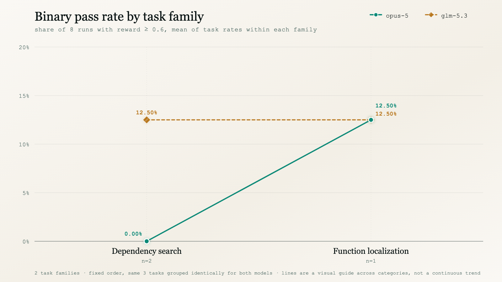

<p align="center">
  <picture>
    <source type="image/svg+xml" srcset="images/hero.svg">
    
  </picture>
</p>

<p align="center">
  <strong>Read-only source-code-comprehension tasks for coding agents, graded on a composite of deterministic checks and LLM-judged rubric criteria.</strong>
</p>

<p align="center"><sub>
  <a href="#summary">Summary</a> · <a href="#results">Results</a> · <a href="#coverage">Coverage</a> · <a href="#task-list">Tasks</a> · <a href="#repository-structure">Structure</a> · <a href="#scoring-methodology">Scoring</a> · <a href="#reproduction">Reproduction</a> · <a href="#license">License</a>
</sub></p>

# Teresa: 3-Task Sample

**Teresa asks a coding agent to explain how a real codebase behaves — trace a dispatch path, locate the function a natural-language description points at, name the exact fork in the logic — without changing any code.** The agent gets a repository checked out at a fixed commit and a natural-language question, instructed to answer in prose rather than edit files; the task instance is additionally flagged `offline: true` / `sanitize: true`. Consistent with that instruction, every one of the 48 sampled runs' recorded `git_patch` is empty — evidence the instruction was followed, not a mechanism that guarantees no file was touched. This is a read-only comprehension domain, not a patch-and-test repair domain.

Each task belongs to one of two families, drawn directly from `task.toml`'s own `family` field — there is no invented difficulty tier or calibration score anywhere in this document:

| family | tasks | what the agent is asked to do |
| :--- | :--: | :--- |
| `dependency_search` | 2 | trace a specific behavior through the real call graph and name the exact file/routine/branch responsible |
| `function_localization` | 1 | locate the function that implements a described behavior, from a natural-language description alone |

This sample is **3 tasks × 2 models × 8 runs = 48 unique runs**, sourced from the `run_1`…`run_8` directories under each task's `trajectories/<trial>/`, where `<trial>` is `claude_opus_5` or `glm_5_3`.

## Summary

| Property | Value |
| :--- | :--- |
| Tasks | **3**, across **3** distinct upstream repositories (one task each) |
| Models | `opus-5` and `glm-5.3` — the `llm_config.model` identifiers recorded in every run are `anthropic/claude-opus-5` and `anthropic/glm-5.3`, each routed through a local proxy (`http://127.0.0.1:<port>`, not a direct vendor endpoint). Those are this harness's configured aliases; they are not a claim about which company is actually serving the underlying weights, and this document does not infer a provider from them. |
| Runs & grid | 8 per model per task = **48 total**; full 2 × 8 grid on every task, no gaps |
| Task families | `dependency_search` (2), `function_localization` (1) — from `task.toml`, not a derived difficulty label |
| Judge | `openai/gpt-5.6-sol`, the sole judge recorded in every one of the 48 runs' `verifier/report/tokens.json` |
| Reward | `reward = mean(pytest, rubric)` ∈ [0, 1] — see [Scoring methodology](#scoring-methodology) |
| Binary pass | `reward ≥ 0.6` (the `threshold` recorded on every run) |
| Languages | 3 (Python 1, Go 1, Java 1) — from `task.toml`'s `language` field |
| Domain | read-only comprehension: empty `git_patch` and `offline`/`sanitize` both `true` on all 48 sampled runs |
| Grading integrity | `violations: []` and `graded_ok: true` on all 48 runs — nothing was voided or flagged |

| metric | opus-5 | glm-5.3 |
|---|--:|--:|
| mean task **binary pass rate** (share of 8 runs meeting the 0.6 threshold, averaged over the 3 tasks) | 4.17% | **12.50%** |
| mean task **mean reward** (plain average of the continuous reward, averaged over the 3 tasks) | 0.2131 | **0.3495** |
| mean agent cost / run (USD, 24 runs) | $7.86 | **$3.08** |
| total agent cost (24 runs) | $188.56 | **$74.03** |
| mean judge cost / run (USD, 24 runs, separate channel) | $0.4236 | $0.4135 |

Agent cost is `metrics.accumulated_cost` from each run's `agent/output.jsonl` — spend by the model under test only. Judge cost is tracked in a separate `verifier/report/tokens.json` per run and is **not** included in the agent-cost figures above or in the cost chart below; it pays for the rubric grading pass on the agent's already-finished answer, not for solving the task.

With three tasks and two families, every figure in this document is a small-sample figure. The per-task numbers are each 8 runs; the family numbers are 2 tasks and 1 task respectively. They are reported as what they are — this corpus's measurements — not as estimates of either model's general capability.

## Results

Both charts group the same 3 tasks into the same 2 families, in the same fixed order, for both models — there is no invented tier or per-model regrouping anywhere in this document. Every point is the mean of that family's task-level values (pass rates in the first chart, agent-cost means in the second), each task weighted equally regardless of how many other tasks share its family (so `function_localization`, with 1 task, is exactly that one task's number). The x-axis is categorical — two fixed family names, not a numeric scale — and the connecting line segment is a visual guide between those two positions, not a claim of a continuous trend between them; the y-axis starts at zero.

### Binary pass rate by task family

<picture>
  <source media="(prefers-color-scheme: dark)" srcset="images/pass_rate_by_family-dark.png">
  <source media="(prefers-color-scheme: light)" srcset="images/pass_rate_by_family-light.png">
  
</picture>

glm-5.3 leads on `dependency_search` (12.50% vs 0.00%), and the whole of that lead is one task: of the 2 tasks in the family, glm-5.3 passes 2 more runs (out of 8) than opus-5 on `Azure/ARO-HCP` (2 vs 0), while `apache/iotdb` is tied with neither model passing a single run (0 vs 0). On `function_localization` the two models tie exactly, at 1 passing run out of 8 each (12.50%) — and that family is a single task (`gwastro/pycbc`), so the flat segment is one comparison, not a family-level equivalence. Across the whole sample opus-5 does not lead on any task by binary pass rate (see the [task list](#task-list)); it leads on mean reward on exactly one, `gwastro/pycbc` (0.4517 vs 0.4144).


## Coverage

<picture>
  <source media="(prefers-color-scheme: dark)" srcset="images/tasks_by_language-dark.png">
  <source media="(prefers-color-scheme: light)" srcset="images/tasks_by_language-light.png">
  
</picture>

**3 tasks across 3 languages, from 3 distinct upstream repositories.** Language is read directly from each task's `task.toml` `language` field. Every repository supplies exactly one task and every task is in a different language, so the task, repository, and language counts all coincide at three; no language or repository is weighted more heavily than another anywhere in this document.

## Task list

Binary pass rate is the share of 8 runs with `reward ≥ 0.6`; mean reward is the plain average of the continuous `reward` across those same 8 runs — the two numbers answer different questions and are shown side by side rather than collapsed into one. `commit` is the `base_commit` short hash the task was pinned to, from `task.toml`.

| task | repo @ commit | family | lang | opus-5 rate | glm-5.3 rate | opus-5 reward | glm-5.3 reward |
|---|---|---|:--:|--:|--:|--:|--:|
| [`dc51ee50`](dc51ee50-0468-41e6-9d58-3aab71e222f8/) | [Azure/ARO-HCP@7cfa677](https://github.com/Azure/ARO-HCP/commit/7cfa67722f96feb45f75681e10abfd11ae4b294a) | `dependency_search` | go | 0.0% | **25.0%** | 0.1002 | **0.4773** |
| [`fa6083c1`](fa6083c1-e606-40d4-821c-22ae69189e04/) | [apache/iotdb@8e5e850](https://github.com/apache/iotdb/commit/8e5e8502d62f3a8310275a242eb39f42f82877ae) | `dependency_search` | java | 0.0% | 0.0% | 0.0873 | **0.1568** |
| [`7b2e7cd5`](7b2e7cd5-f024-42b1-bfb1-ee00b783ef43/) | [gwastro/pycbc@f1e16ea](https://github.com/gwastro/pycbc/commit/f1e16ea53cff7c7ee60182aa067a5271d7628daa) | `function_localization` | python | **12.5%** | **12.5%** | **0.4517** | 0.4144 |

## Repository structure

```
teresa-samples/
├── README.md
├── LICENSE
├── images/
│   ├── hero.{svg,png}
│   ├── pass_rate_by_family-{light,dark}.{svg,png}
│   ├── cost_by_family-{light,dark}.{svg,png}
│   └── tasks_by_language-{light,dark}.{svg,png}
├── scripts/
│   └── generate_charts.py        # reads the data below, prints the reproducible summary, writes the SVGs above
└── <uuid>/                       # one directory per task (3)
    ├── task.toml                 # repo, base_commit, language, family, environment/timeout config
    ├── instruction.md            # the verbatim prompt handed to the agent
    ├── environment/              # Dockerfile, sanitize.py
    ├── solution/                 # answer.md (reference answer), solve.sh
    ├── tests/                    # test.sh, test_output.py, test_weights.json, rubric.json, truth.md
    └── trajectories/
        ├── claude_opus_5/        # opus-5's 8 runs on this task
        │   ├── pass_8_summary.json   # the 8-run reward/pass/threshold summary this README's numbers are computed from
        │   └── run_1 … run_8/
        │       ├── config.json, lock.json, result.json, trial.log
        │       ├── artifacts/manifest.json
        │       ├── agent/
        │       │   ├── output.jsonl          # the agent's final answer, metrics.accumulated_cost, model config
        │       │   ├── trajectory.json       # the full step-by-step agent trajectory
        │       │   ├── metrics.json, run-metadata.json
        │       │   ├── instruction.md, answer.md
        │       │   └── rollout.log
        │       └── verifier/
        │           ├── teresa-details.json, test-stdout.txt, reward.json, reward.txt
        │           └── report/
        │               ├── reward.json           # {pytest, rubric, reward}
        │               ├── reward-details.json   # per-test and per-criterion breakdown
        │               ├── tokens.json           # judge token usage + cost_usd (separate from agent cost)
        │               └── ctrf.json             # deterministic test results, CTRF format
        └── glm_5_3/              # glm-5.3's 8 runs on this task, identical layout to claude_opus_5/ above
```

The task bundle — `task.toml`, `instruction.md`, `environment/`, `solution/`, `tests/` — is stored once per task and shared by both trials, so there is exactly one authoritative definition of each task and no second copy that could drift from it. During a run the agent sees only the built repository and `instruction.md`; `solution/` and `tests/` are used exclusively by the verifier. Each of the 48 runs appears exactly once, under its own `trajectories/<trial>/run_{1..8}/`, and `scripts/generate_charts.py` asserts its run and task totals rather than trusting the directory walk.

## Scoring methodology

Grading combines two channels into the recorded `reward`. `tests/test.sh` runs inside a separate, network-enabled verifier environment (`environment_mode = "separate"` in `task.toml`) and computes the deterministic channel only; by its own comment, a further step it calls "the teresa grader" additionally runs the rubric judge and blends the two channels into the `reward` that ends up in `verifier/report/reward.json` and `pass_8_summary.json` — that blending step itself is not among the files shipped in this sample:

* **`pytest`** — a deterministic layer. `tests/test_output.py` runs under pytest against the agent's answer; each test carries a signed weight from `test_weights.json` (across the 3 tasks: 11–18 weighted tests per task, 43 in total, each task mixing positive-weight tests with a handful of negative-weight penalty tests — for reward hacking, undisclosed edits, or unsupported claims). The score is `sum(weight for tests that PASSED) / sum(positive weights only)`, clipped to `[0, 1]`: a penalty test only reduces the score if it *fires* (passes), and dividing by the positive-weight total keeps a clean answer capped at 1.0 even though a penalty test's complement is nearly always present.
* **`rubric`** — an LLM-judged layer. A single judge, `openai/gpt-5.6-sol` (confirmed as the only judge model recorded across all 48 runs' `verifier/report/tokens.json`), scores the answer against a task-specific `rubric.json`: 14–34 criteria per task (74 total across the 3 tasks), each either positive (rewards a correct, well-evidenced claim) or negative (penalizes an unsupported claim, a missed distinction, or — mirroring the pytest layer — evidence that the agent edited files it was told not to touch).

```
reward = (pytest + rubric) / 2                     # ∈ [0, 1], from tests/test.sh's own comment
passed = reward >= 0.6                              # the "threshold" recorded on every run
binary pass rate (this document) = mean(passed) over a task's 8 runs, per model
mean reward (this document)      = mean(reward) over a task's 8 runs, per model
```

Binary pass rate and mean reward are reported side by side throughout this document because they answer different questions: binary pass rate is the share of runs that cleared the 0.6 bar; mean reward is the plain average of the underlying continuous score and is sensitive to *how far* a run landed from that bar, not just which side of it. Neither is `pass@k` (the probability of at least one success in *k* tries): `pass_8_summary.json` does carry a `pass_at_k` field per task, but this document does not surface it — the numbers reported here are a per-run rate, not an at-least-one-solve figure, and should not be read as one.

All 48 sampled runs' `verifier/report/tokens.json` name the same judge model; all 48 rows of every `pass_8_summary.json` carry `violations: []` and `graded_ok: true` — nothing in this sample was voided or flagged during grading.

## Reproduction

`scripts/generate_charts.py` re-derives the task/family/language aggregates quoted in this document — binary pass rate, mean reward, agent cost, judge cost, and the language breakdown — directly from the shipped `pass_8_summary.json`, `agent/output.jsonl`, `verifier/report/tokens.json`, and `task.toml` files (language comes from `task.toml`), and writes the six chart SVGs under `images/` from those same aggregates. It uses only the Python standard library, makes no network access, installs no dependency, and executes no task's Docker environment, agent, or verifier — it only reads the already-graded artifacts described in [Repository structure](#repository-structure).

Other numbers quoted elsewhere in this document are **not** computed by this script: the per-task rubric-criteria and pytest-weighted-test counts in [Scoring methodology](#scoring-methodology) are read directly from each task's `rubric.json` and `test_weights.json`, and the `base_commit` short hashes in the [task list](#task-list) are read directly from each task's `task.toml`.

```bash
python3 scripts/generate_charts.py
```

Its guards double as a consistency check on the corpus itself: it counts a directory as a task only if it ships both its own `task.toml` and a `trajectories/` subtree for both trials, then asserts exactly 8 runs per model per task with run ids exactly `1`–`8`, that every run's `threshold` is 0.6, that every run's `passed` flag agrees with `reward >= threshold`, and that `pass_8_summary.json`'s own `n_passed` recomputes exactly while its `pass_rate`/`mean_reward` recompute within `1e-4` of a full-precision recomputation from that file's own per-run rows (not exact equality — see [Scoring methodology](#scoring-methodology)) — any of those failing would abort the script rather than silently print a wrong number. The task/family/corpus aggregates in this document are then built directly from `pass_8_summary.json`'s own published four-decimal `pass_rate`/`mean_reward` figures, guard-checked as above, not from a second, independently-rounded recomputation of them. Expected output opens with:

```
========================================================================================
TERESA -- 3 tasks, 3 distinct upstream repositories, 3 languages, 2 models, 8 runs/model/task = 48 unique runs
========================================================================================
```

...and ends by writing the same six SVGs included under `images/`; running it again reproduces byte-identical SVG output, since every value it draws from is either shipped JSON or a fixed layout constant.

The script emits **SVG only** and does not rasterize PNGs. The `.png` fallbacks referenced from the `<picture>` tags above (and `images/hero.png`) are separate browser exports of those exact SVGs, each rendered at its SVG's own native pixel dimensions (1600×900 for the two line charts, 1600×1200 for the language donut, 1760×532 for the hero) — not output of this script, and no specific render command is documented here.

## License

MIT © 2026 Ethara.AI — see [LICENSE](LICENSE).

Upstream repository content referenced by these tasks (`gwastro/pycbc`, `Azure/ARO-HCP`, `apache/iotdb`) remains under its own respective license.
